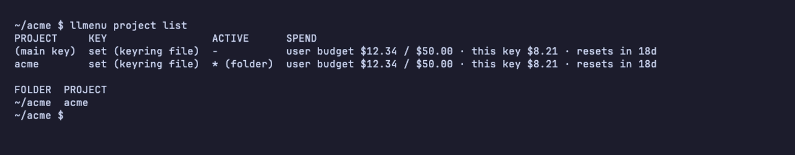

# Budget and spend

[← README](../README.md)



LiteLLM gateways often give each person and each project a monthly budget.
llmenu shows the budget that applies to the key in use, and that key's share:

- **in the menu**, next to the project,
- **in `llmenu project list`**, for the main key and every project,
- **in Claude Code's status line**, in sessions started with `llmenu claude`.
  Your own status line keeps running; llmenu adds one line below it, e.g. in
  a session with project acme:

  ```text
  project acme · team budget $40.00 / $100.00 · this key $12.45 · resets in 19d
  ```

  To turn it off: `llmenu config set claude.statusline false` (or
  `llmenu setup claude`).

  Without your own status line, llmenu's line also names the model.

A project's key spends from its team's budget, your personal key from your
user budget; a key's own budget is shown instead if it has less left. Without
any budget, llmenu shows what the key has spent (`$3.20 spent`).

The numbers come from LiteLLM's `/key/info` and `/user/info`, which every key
may ask about itself, so no admin rights are needed. They are LiteLLM's
estimate from its prices, not the provider's invoice. llmenu asks the gateway
at most once a minute and caches the result without the key.
